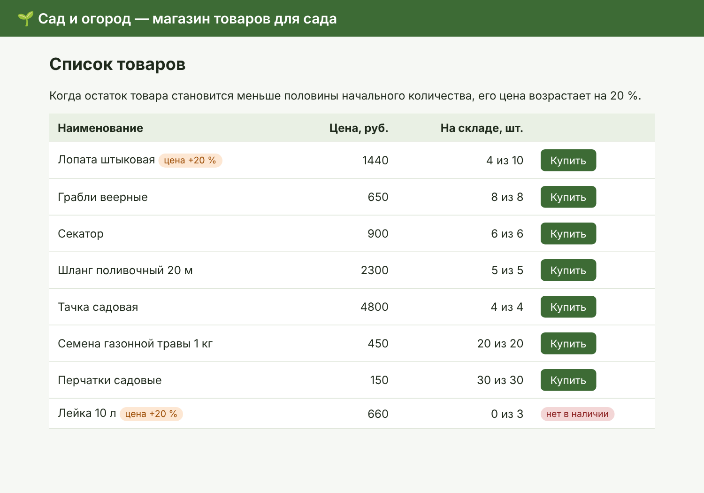
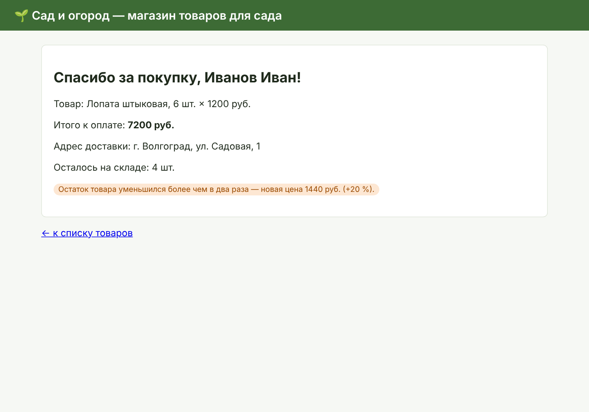

[](https://github.com/Scutun/PTLab2/actions/workflows/ci-cd.yml)

# Лабораторная 2 по дисциплине "Технологии программирования"

**Тема:** изучение фреймворка MVC. **Вариант:** 11 — магазин товаров для сада.

**Приложение в сети:** https://ptlab2-plotnikov.onrender.com/.

## Постановка задачи

На основе учебного проекта интернет-магазина на Django
([kpdvstu/PTLab2](https://github.com/kpdvstu/PTLab2)) требуется:

1. выбрать лицензию и добавить её в проект;
2. доработать магазин в соответствии с вариантом, написать модульные тесты
   (в отдельной ветке, с последующим слиянием в основную);
3. обеспечить автоматическое тестирование и развёртывание приложения
   на хостинге (любые инструменты CI/CD);
4. сделать выводы.

**Вариант 11.** В магазине имеется определённое количество товара каждого вида.
После покупки количество товара уменьшается. Если количество товара
уменьшилось более чем в два раза, его цена возрастает на 20 %.

## Краткое описание проекта

Приложение построено по шаблону MVC (в терминах Django — MTV):

| Компонент MVC | В проекте                                        | Назначение                                       |
| ------------- | ------------------------------------------------ | ------------------------------------------------ |
| Модель        | `shop/models.py` — `Product`, `Purchase`         | данные и бизнес-логика (остатки, повышение цены) |
| Представление | `shop/templates/shop/*.html`                     | HTML-страницы                                    |
| Контроллер    | `shop/views.py`, `shop/urls.py`, `shop/forms.py` | обработка запросов, проверка данных формы        |

Реализация варианта:

- у товара (`Product`) есть начальное (`initial_quantity`) и текущее (`quantity`) количество;
- метод `Product.sell(count)` списывает товар со склада; купить больше, чем есть,
  нельзя (`OutOfStockError`, а в форме — сообщение об ошибке);
- если после продажи `2 · quantity < initial_quantity` (количество уменьшилось **более чем
  в два раза**), цена однократно увеличивается на 20 % с округлением до рубля, флаг
  `price_increased` не даёт поднять цену повторно;
- покупка (`Purchase`) хранит количество и цену за единицу на момент покупки:
  покупатель, из-за которого остаток упал ниже половины, платит ещё старую цену;
- закончившийся товар помечается «нет в наличии», страница покупки его не продаёт;
- строка товара блокируется на время покупки (`select_for_update`), поэтому два
  одновременных покупателя не смогут купить один и тот же остаток.

| Список товаров                 | Оформленная покупка               |
| ------------------------------ | --------------------------------- |
|  |  |

## Используемые технологии

- Python 3.12, Django 5.2 (LTS), HTML/CSS;
- PostgreSQL (локально и в GitHub Actions — PostgreSQL 16, на хостинге — [Neon](https://neon.com));
- `dj-database-url` — подключение к БД через переменную `DATABASE_URL`;
- `gunicorn` — WSGI-сервер, `whitenoise` — раздача статических файлов;
- `unittest` / `django.test`, `coverage` — модульное тестирование и покрытие;
- Git, GitHub Actions — CI/CD; [Render](https://render.com) — хостинг.

## Запуск локально

```powershell
conda create -n tplab2-env python=3.12
conda activate tplab2-env
pip install -r requirements.txt
$env:DATABASE_PASSWORD = "ps_password"     # пароль пользователя postgres
python manage.py migrate
python manage.py loaddata products.yaml
python manage.py test shop
python manage.py runserver
```

## Тестирование

26 модульных тестов (`shop/tests/`): исходные тесты учебного проекта, учёт остатков,
граница «ровно в два раза» (цена не меняется) и «более чем в два раза» (цена +20 %),
однократность повышения, округление, нечётное начальное количество, страницы списка
и покупки, покупка сверх остатка, покупка закончившегося товара, неверная форма,
несуществующий товар (404). Покрытие кода приложения — 90 %.

```text
Ran 26 tests
OK
```

## Выводы

1. Изучен шаблон MVC и его реализация в Django (MTV): модель отвечает за данные и
   бизнес-правила, шаблон — за отображение, представление (view) — за обработку запроса.
2. Логика варианта (остатки и повышение цены) реализована в модели `Product`, поэтому
   она одинаково работает из веб-интерфейса, админки и тестов, а контроллер остаётся тонким.
3. Функциональность разработана в отдельной ветке и слита с `master` только после
   прохождения всех тестов.
4. Настроен конвейер CI/CD: каждое изменение автоматически тестируется на реальной
   PostgreSQL, а изменения в `master` после успешных тестов автоматически
   разворачиваются на Render.
